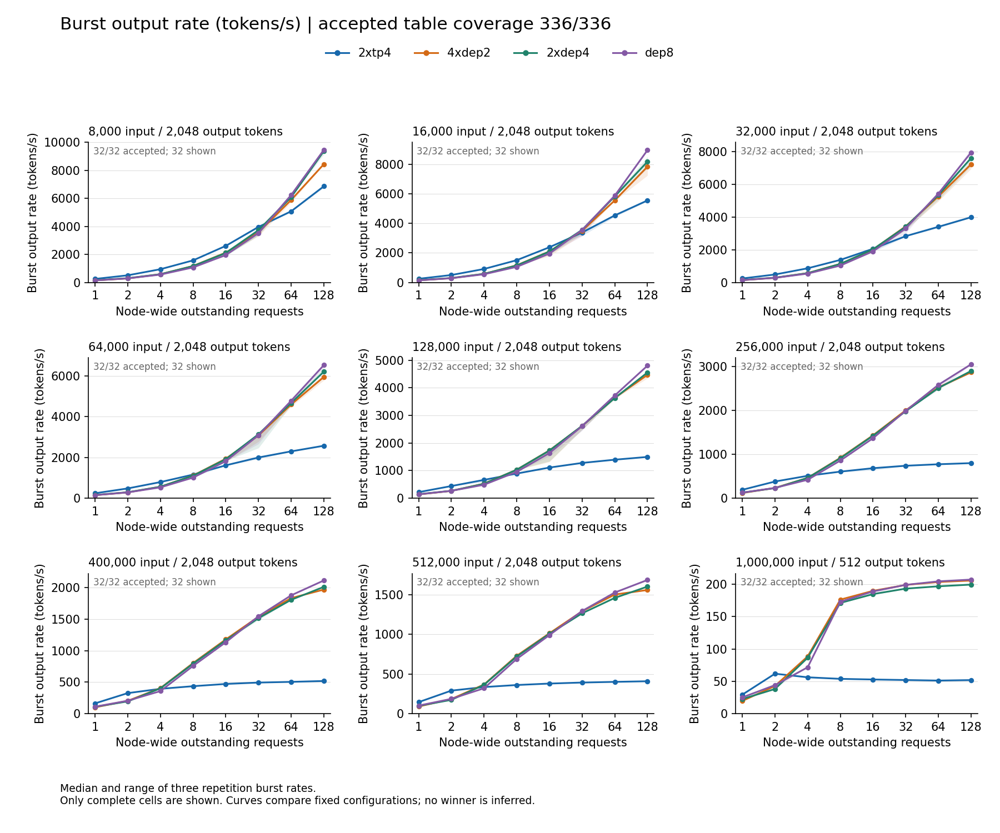

<!-- register: repository guide | reader: inference engineer evaluating B200 serving layouts, then a reproducer | consumed: top-down read, first screen decides whether to go deeper -->
# DeepSeek V4.1 Flash 1017 on eight NVIDIA B200 GPUs

This repository measures how to serve [DeepSeek-V4.1-Flash-1017](https://huggingface.co/deepseek-ai/DeepSeek-V4.1-Flash-1017) with vLLM on one node of eight NVIDIA B200 GPUs. It publishes the results, the sanitized data tables behind them, and the harness used to capture and verify them.

The work asks two questions:

1. **How should the eight GPUs be split?** Four fixed configurations were compared: two tensor-parallel engines of four GPUs each (`2xtp4`), and three data- plus expert-parallel (DEP) layouts: four engines of two GPUs (`4xdep2`), two engines of four GPUs (`2xdep4`), and one engine across all eight (`dep8`). Each was measured from 8,000 to 1,000,000 input tokens and from 1 to 128 outstanding requests.
2. **Does speculative decoding help `2xtp4`?** Static DSpark speculative decoding with five draft tokens per step (K5) was compared against the same recipe with speculation disabled (NoSpec), on throughput, latency under load and answer quality. DSpark integration in vLLM is tracked in [vLLM issue 46910](https://github.com/vllm-project/vllm/issues/46910).

Most measurements are bursts: N requests dispatched together and not replaced as they finish, so the N **outstanding requests** include queued as well as running work. **Burst output rate** is valid output tokens divided by the time from first dispatch to last completion. **First output** is the time from dispatch to the first nonempty streamed output chunk. **Cold** requests use cache-busted prompts; **warm-prefix** requests reuse a cached prompt prefix. Measurements were captured in November 2026 on one node and compare whole configurations, with the boundaries listed under [limits](#limits).

## Results

**`2xtp4` gives the highest single-request output rate; the DEP layouts deliver more total throughput once enough requests are in flight.** With one cold request, `2xtp4` generated 1.43 to 1.58 times the output rate of the next-best layout at every input length from 8K to 512K (258 against 153 to 163 tokens/s at 8K). With many requests outstanding, the DEP layouts lead, and the request count at which `2xtp4` stops leading falls as input grows:

| Input tokens | Highest tested request count where `2xtp4` led | Burst output rate at 128 outstanding requests: `2xtp4` / DEP layouts |
| ---: | ---: | --- |
| 8,000 | 32 | 6,866 / 8,443 to 9,460 tokens/s |
| 64,000 | 8 (repetition ranges overlap with `4xdep2`) | 2,571 / 5,948 to 6,530 tokens/s |
| 128,000 | 4 | 1,494 / 4,471 to 4,805 tokens/s |
| 512,000 | 2 | 408 / 1,557 to 1,683 tokens/s |

Tested request counts were 1, 2, 4, 8, 16, 32, 64 and 128. Cold requests generated 2,048 output tokens, except 512 at 1M input. Values are medians of three repetitions; the [chart report](results/fixed-comparison/report/README.md) shades the range across repetitions.



**First output at one request depends on the layout, and under load `2xtp4` queues.** At one cold request, first output took 0.11 s on `2xtp4`, 0.12 s on `dep8`, 0.13 s on `2xdep4` and 0.16 s on `4xdep2` at 8K input; at 128K the same layouts took 1.49, 1.47, 1.84 and 2.23 s. With 32 outstanding 128K-input requests, the median of three per-repetition median first-output times was 19.2 s on `2xtp4` (repetitions 19.1 to 19.3 s) and 4.6 to 4.7 s on the DEP layouts (repetitions 4.6 to 6.5 s).

**With a warm prefix, `2xtp4` led throughput and trailed on first output.** At 32 outstanding requests with 128K to 512K input and achieved cache-hit fractions of at least 0.998, the four layouts produced 3,385 to 4,167 output tokens/s with `2xtp4` highest at each length. Its first output took about 0.9 to 1.4 s against 0.26 to 0.52 s for the DEP layouts. The warm 1M row requests 512 output tokens and is reported separately; there `2xtp4` was lowest at 1,991 tokens/s against 2,061 to 2,358.

**Static DSpark K5 recorded higher output throughput than NoSpec on `2xtp4`, with similar quality on a selected panel and one unresolved latency guardrail.** Ratios are K5 divided by NoSpec. Both arms share the image, model and layout; K5 adds the draft and verification path, so these are whole-recipe comparisons.

| Measurement | K5 / NoSpec |
| --- | --- |
| Fixed 2,048-token output, three paired repetitions: output-token throughput | 1.73× and 1.83× at 8K input with 1 and 8 requests; 1.83× and 1.34× at 64K |
| Same screen: first output at 64K input, one request | 1.075× median, with paired repetitions straddling the 1.05 guardrail, so the screen was recorded inconclusive |
| Natural-stop answers, ~8K input, 8 concurrent requests: output-token throughput | 2.10× median; range 1.35 to 7.23× across five prompt blocks |
| Natural-stop answers, ~64K input, 8 concurrent requests | 1.67× median; range 0.81 to 1.70×, one block slower |
| Natural-stop answers, one request | 1.00× at 8K, 1.01× at 64K |
| Open-loop load at 6 offered requests/s: correct answers/s inside each 60-second window | 1.008× (262 against 260 correct in each of two windows) |
| Same load: correct answers completed within one second of dispatch | 1.087× and 1.092× (262 against 241 and 240) |
| Selected quality panel, 200 tasks × 2 seeds, thinking disabled | 71.25% K5 against 71.5% NoSpec; paired task-cluster bootstrap interval −2.75 to +2.00 percentage points |

Natural-stop answers were short: 3 to 16 tokens per single request and 29 to 103 tokens per eight-request group, so those ratios reflect prefill, first output and cache history more than sustained decoding, and they count tokens from incorrect answers. The one-second limit is one of four predeclared limits; at 5, 15 and 60 seconds the ratio was 1.008×. The load panel cycled ten underlying questions, and K5 completed all 360 arrivals per window against NoSpec's 357, so the unrestricted rate is capped by the offered load. The [validation report](results/finalist-validation/report.md) and [tuning report](results/tuning-adaptation/README.md) give the full tables. The same tuning screens rejected one CUDA graph capture-size configuration on `2xtp4` and a 16,384-token prefill budget on `dep8`; the budget improved single-request first output by 6.0% at 128K and 21.6% at 256K but missed the predeclared 10% requirement at both lengths.

## What was measured

| Layout | Engines | GPUs per engine | Parallelism per engine | Attention backend | KV cache format |
| --- | ---: | ---: | --- | --- | --- |
| `2xtp4` | 2 | 4 | Tensor parallel 4 | `FLASHINFER_MLA_SPARSE_DSV41` | `fp8` |
| `4xdep2` | 4 | 2 | Data parallel 2, expert parallel 2 | `FLASHINFER_MLA_SPARSE_DSV41` | `fp8` |
| `2xdep4` | 2 | 4 | Data parallel 4, expert parallel 4 | `FLASHINFER_MLA_SPARSE_DSV41` | `fp8` |
| `dep8` | 1 | 8 | Data parallel 8, expert parallel 8 | `FLASHMLA_MEGA_ATTN_DSV41` | `fp8_ds_mla` |

All layouts and both K5 arms used the pinned image `vllm/vllm-openai@sha256:aeb580d55ee3dcccd7b5c78d7871326f367bee5cfd8ca8e411c253d7983a0046` (vLLM `0.33.0rc1.dev447+ge0d00e4b8`) and model revision `1bae0e1088993b9b82de08f59de5be5a34e42170`, with a 1,048,576-token sequence limit and prefix caching. A pinned router placed requests across engines with retries disabled. The K5 study records driver 580.173.02, CUDA 13.0, Torch 2.14.0, NCCL 2.30.7 and two Intel Xeon Platinum 8580 CPUs. The [configuration guide](docs/frozen-configurations.md) has the full pins, CPU offload settings and CPU placement.

| Study | Scope | Accepted data |
| --- | --- | --- |
| [Layout comparison](results/fixed-comparison/README.md) | Cold: 4 layouts × 9 input lengths × 8 request counts. Warm prefix: 4 layouts × 4 input lengths × 3 request counts | 336 cells (288 cold, 48 warm), 1,008 repetitions, 29,508 requests |
| [1M-input supplement](results/context-1m-output2048/report.md) | 1M input with 2,048 output tokens; the main comparison used 512 at 1M | 44 cells, 132 repetitions, 3,552 requests |
| [Tuning screens](results/tuning-adaptation/README.md) | DSpark K5, graph capture and prefill budget against matched baselines, fixed 2,048-token output | 12 comparisons, 72 repetitions, 324 requests |
| [K5 validation](results/finalist-validation/README.md) | K5 against NoSpec on `2xtp4`: natural-stop bursts, open-loop load, quality panel | Captured November 8 to 9, 2026 |

Measured requests were streamed Chat Completions with temperature and top-p at 1.0. The layout comparison disabled thinking; the K5 quality and load panels include separate thinking-disabled and thinking-enabled profiles. The [comparison contract](docs/comparison-contract.md) defines every metric and timing boundary.

## Limits

- Each burst is finite and is not replenished. The results do not establish a maximum sustainable request rate or production reliability.
- Layouts differ in attention backend and KV format as well as GPU grouping, and K5 changes the decoding path as a whole recipe; results belong to the whole configuration and are not attributed to one setting.
- Cold prompts used cache-busted namespaces; a cache flush was not verified. Layouts ran one after another, so drift over time is not ruled out. Some rankings fall inside the range across three repetitions.
- K5 natural-stop ratios come from five prompt blocks that share one engine history, with short answers and repeated cache reuse.
- The K5 load study covers two 60-second windows per rate over ten repeated questions. Eleven of twelve load windows have no queue sample during drain, and the K5 load windows were analysed from recovered evidence after a failed evidence seal and were not replayed.
- K5 quality was measured on a selected 200-task panel and does not establish general quality equivalence.
- All data comes from one node. Fresh-node replication was not performed, and host CPU and memory details are not part of the layout export.

## Repository contents

| Path | Contents |
| --- | --- |
| `results/` | One folder per study: report, sanitized tables, charts where applicable, and `SHA256SUMS` |
| `docs/` | Comparison contract, configuration guide, reproduction notes, publication policy |
| `reproduce/` | Capture harness, launcher, verifiers and report renderers |
| `configs/` | Frozen layout profiles, dependency locks and dataset sources |
| `tests/` | Unit tests and synthetic fixtures for the harness |

## Verify the published results

Python 3.12 or later. These commands recompute table arithmetic and check file hashes for each study:

```sh
python3 -B reproduce/verify_result_package.py results/fixed-comparison
python3 -B reproduce/verify_result_package.py results/context-1m-output2048
python3 -B reproduce/verify_result_package.py results/tuning-adaptation
python3 -B reproduce/verify_result_package.py results/finalist-validation
```

They do not rerun inference or rescore model answers. Raw responses, failure logs and interrupted attempts are retained privately; public provenance identifies the original producer code by content hash.

## Run the harness locally

The fixtures exercise streaming, persistence, interruption and recovery with synthetic clocks and bind ephemeral loopback ports. Use fresh output directories outside the checkout:

```sh
python3 -B reproduce/campaign.py plan --plan docs/comparison-contract.md --output /tmp/dsv41-ledger.json
python3 -B reproduce/campaign.py fixture --output /tmp/dsv41-fixture
python3 -B reproduce/verify_fixture.py /tmp/dsv41-fixture
python3 -B reproduce/campaign.py fixture-burst --output /tmp/dsv41-fixture-burst
python3 -B -m unittest discover -s tests -v
```

`reproduce/launcher.py` renders the digest-pinned Docker and router arguments for a layout without starting any process. Running on a live node requires operator assembly and the preconditions in the [reproduction notes](docs/reproduction-notes.md); the harness is not a turnkey deployment. The [publication policy](docs/publication-policy.md) explains what stays outside Git.
