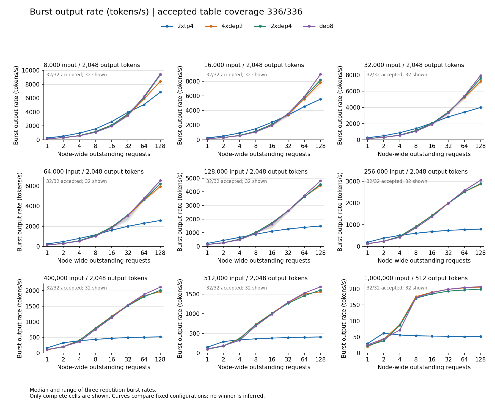

<!-- register: repository guide | reader: applied AI researcher judging serving and benchmarking evidence, then a reproducer | consumed: top-down read; the first screen decides whether to open a study -->
# DeepSeek V4.1 Flash 1017 on eight NVIDIA B200 GPUs

Measurements of [DeepSeek-V4.1-Flash-1017](https://huggingface.co/deepseek-ai/DeepSeek-V4.1-Flash-1017) served with vLLM on one eight-B200 node: capacity at a latency target with thinking enabled, static DSpark speculative decoding with five draft tokens (K5) against no speculation (NoSpec), and four parallel layouts from 8K to 1M input tokens. Each study publishes sanitized tables, its configuration and a checksum-verified result package. DSpark integration in vLLM is tracked in [vLLM issue 46910](https://github.com/vllm-project/vllm/issues/46910).

## Findings

**A random-token trace replay cut speculative acceptance well below real text.** A replay of a private request trace through vLLM's `timed_trace` benchmark dataset, which samples prompt token IDs uniformly from the vocabulary, ran K5 at a mean acceptance length of 1.81 (0.81 accepted draft tokens per step). On the same engine, real-text W1 prompts gave 2.96 (1.96 per step). The replay also used the plain completions endpoint and forced output lengths, and no NoSpec replay was run, so the gap is not attributed to random tokens alone. [SPEED-Bench](https://arxiv.org/abs/2604.09557) reports that random-token inputs can push acceptance either way and on average overstated speculative throughput in its tests; trace replays used to size a speculative decoder need real-text prompts. ([capacity study](results/capacity-at-latency-target/report.md#speculative-acceptance-and-a-trace-replay-control))

**With thinking on, two TP4 K5 replicas met a 30-second completion p95 on every run up to 0.544 eight-turn or 0.267 four-turn long-context conversations per second per node.** These are the highest tested loads where all runs passed, each on one arrival draw; the 0.539 W1 level passed four of four runs over two draws. W1 prompts run 49K to 116K tokens per turn and W2 prompts 243K to 445K. At 5 to 6% more W1 load, one of three draws passed. ([capacity study](results/capacity-at-latency-target/report.md#capacity-of-2xtp4-k5))

**The limit tracked total prompt tokens, not uncached prefill.** For `2xtp4` K5, all 9 draws below 140K offered prompt tokens/s per replica passed and 3 of the 9 draws from 141.9K to 156.1K passed, in both workloads, although W2 conversations are about twice as long and arrive half as often. The prefix cache served 85.5% of W1 prompt tokens and 74.6% of W2, so uncached prefill at the limit differed (about 20.7K against 36.0K tokens/s per replica). The mechanism is not measured.

**Without speculation, the same engine configuration missed the target at the lowest load tested.** Side by side on identical streams, NoSpec failed at 0.175 W1 and 0.081 W2 conversations/s per engine (completion p95 48.9 to 55.7 s) where K5 passed at 16.9 to 20.8 s; NoSpec's own limit was not located. In a separate paired capture at loads where NoSpec was already overloaded, K5 turns took 0.38 times as long as NoSpec on W1 (95% interval over conversations 0.35 to 0.40) and 0.47 times on W2 (0.40 to 0.55), with about 2.5 times the decode rate; those ratios include NoSpec's queueing.

**One arrival draw is not enough near the limit.** At the same measured W1 load, two Poisson arrival draws gave node completion p95 of 27.8 and 30.5 s, while the two replicas, which receive identical streams, never differed by more than 1.9 s in any W1 run. On W2 at 0.30 conversations/s per node, three draws spanned 29.9 to 40.5 s against a largest replica difference of 5.6 s. The generator's rate settings also missed measured arrivals by up to 18% over 360 s, so this repository reports measured arrivals.

**One `dep8` engine had 1.5 to 2.4 times the tail latency of `2xtp4` at the same loads** (median of runs over median of runs on the same draw). On the same W1 draw at 0.539 conversations/s per node, `dep8` K5 completion p95 was 58.0 to 60.7 s against 27.5 to 28.9 s; no tested `dep8` load passed all three runs. The configurations differ in attention backend, KV format, MoE backend and sequence limits, and `dep8` placed requests across ranks without session affinity, which cut its prefix-cache hits (59% to 68% of W1 prompt tokens against 85.4%). The comparison is between complete configurations.

**In cold bursts from 8K to 512K input, `2xtp4` led at one request and data- and expert-parallel layouts led at larger batches.** Cache reuse changed some rankings. ([layout comparison](results/fixed-comparison/README.md))

These are single-node measurements of whole configurations. Generated answers in the load studies are not scored, so they do not measure correct-task throughput; a selected 200-task panel with thinking off found similar K5 and NoSpec quality on `2xtp4`.

## Studies

| Study | Scope | Accepted data |
| --- | --- | --- |
| [Capacity at a latency target](results/capacity-at-latency-target/report.md) | `2xtp4` K5, `2xtp4` NoSpec and `dep8` K5; thinking on, natural output up to 4,096 tokens; two multi-turn workloads; 30 s completion p95 target | 64 windows (46 node-level verdicts), a paired turn-level capture and two trace-replay controls, November 19 to 20, 2026 |
| [Multi-turn load](results/sustained-speculation-layouts/report.md) | `2xtp4` and `dep8`, K5 on and off; thinking off, 400 forced output tokens | 39 core windows and one diagnostic; acceptance and finite-window latency |
| [K5 validation](results/finalist-validation/README.md) | K5 against NoSpec on `2xtp4`: natural-stop bursts, open-loop load, quality panel | Captured November 8 to 9, 2026 |
| [Tuning screens](results/tuning-adaptation/README.md) | DSpark K5, graph capture and prefill budget against matched baselines, fixed 2,048-token output | 12 comparisons, 72 repetitions, 324 requests |
| [Layout comparison](results/fixed-comparison/README.md) | Cold: 4 layouts × 9 input lengths × 8 request counts. Warm prefix: 4 layouts × 4 input lengths × 3 request counts | 336 cells (288 cold, 48 warm), 1,008 repetitions, 29,508 requests |
| [1M-input supplement](results/context-1m-output2048/report.md) | 1M input with 2,048 output tokens; the main comparison used 512 at 1M | 44 cells, 132 repetitions, 3,552 requests |

**Measured arrivals** are conversations whose first turn was scheduled in a window's 360-second measured period of the realized arrival schedule, divided by 360; they replace the load generator's rate setting wherever load is reported. **Offered prompt tokens/s** counts prepared prompt tokens of those conversations' turns over 360 s, including cached prefix. **Completion p95** counts every scheduled measured turn, and a turn that never finishes counts as infinitely late. **Burst output rate**, used in the layout comparison, is valid output tokens divided by the time from first dispatch to last completion of N requests sent together. **First output** is the time from dispatch to the first nonempty streamed chunk. **Cold** requests use cache-busted prompts; **warm-prefix** requests reuse a cached prefix.

## Earlier results

### Layouts in cold and warm bursts

With one cold request, `2xtp4` generated 1.43 to 1.58 times the output rate of the next-best layout at every input length from 8K to 512K (258 against 153 to 163 tokens/s at 8K). With many requests outstanding, the DEP layouts lead, and the request count at which `2xtp4` stops leading falls as input grows:

| Input tokens | Highest tested request count where `2xtp4` led | Burst output rate at 128 outstanding requests: `2xtp4` / DEP layouts |
| ---: | ---: | --- |
| 8,000 | 32 | 6,866 / 8,443 to 9,460 tokens/s |
| 64,000 | 8 (repetition ranges overlap with `4xdep2`) | 2,571 / 5,948 to 6,530 tokens/s |
| 128,000 | 4 | 1,494 / 4,471 to 4,805 tokens/s |
| 512,000 | 2 | 408 / 1,557 to 1,683 tokens/s |

Tested request counts were 1 to 128 in powers of two. Cold requests generated 2,048 output tokens, except 512 at 1M input. Values are medians of three repetitions; the [chart report](results/fixed-comparison/report/README.md) shades the range across repetitions.



Under load `2xtp4` queues: with 32 outstanding 128K-input requests, its first output (median of three per-repetition medians) was 19.2 s against 4.6 to 4.7 s on the DEP layouts. With a warm prefix at 32 outstanding requests and 128K to 512K input, `2xtp4` had the highest output throughput (3,385 to 4,167 tokens/s across layouts) and the slowest first output (about 0.9 to 1.4 s against 0.26 to 0.52 s).

### K5 validation with thinking off

| Measurement | K5 / NoSpec |
| --- | --- |
| Fixed 2,048-token output, three paired repetitions: output-token throughput | 1.73× and 1.83× at 8K input with 1 and 8 requests; 1.83× and 1.34× at 64K |
| Natural-stop answers, ~8K input, 8 concurrent requests: output-token throughput | 2.10× median; range 1.35 to 7.23× across five prompt blocks |
| Open-loop load at 6 offered requests/s: correct answers completed within one second | 1.087× and 1.092× (262 against 241 and 240) |
| Selected quality panel, 200 tasks × 2 seeds | 71.25% K5 against 71.5% NoSpec; paired interval −2.75 to +2.00 percentage points |

The natural-stop answers were short (3 to 16 tokens per single request), so those ratios reflect prefill and cache history more than sustained decoding. The [validation report](results/finalist-validation/report.md) has every limit and repetition, including an inconclusive first-output guardrail at 64K.

### Multi-turn load with forced output

With 400 forced output tokens and thinking off, K5 reduced completion p95 on both layouts. Loads are measured arrivals; W1 values are from one arrival draw and W2 ranges span two.

| Configuration | W1 at 0.531 conversations/s: completion p95 | W2 at 0.322 to 0.331 conversations/s: completion p95 |
| --- | ---: | ---: |
| `2xtp4`, K5 | 4.17 s | 17.56 to 17.75 s |
| `2xtp4`, NoSpec | 10.51 s | 87.43 to 107.77 s |
| `dep8`, K5 | 5.36 s | 15.56 to 19.61 s |
| `dep8`, NoSpec | 8.39 s | 27.10 to 34.04 s |

Earlier versions of this table labeled these loads 0.45 and 0.32, the generator's settings. K5 acceptance length ranged from 2.707 to 3.126. A cache-confounded client control left this study's maximum sustainable rates unqualified. Against the capacity study, the much lower p95 at the same W1 arrival rate most likely reflects 400 forced output tokens instead of thinking output up to 4,096, though prompts and client also differ.

## What was measured

| Layout | Engines | GPUs per engine | Parallelism per engine | Attention backend | KV cache format |
| --- | ---: | ---: | --- | --- | --- |
| `2xtp4` | 2 | 4 | Tensor parallel 4 | `FLASHINFER_MLA_SPARSE_DSV41` | `fp8` |
| `4xdep2` | 4 | 2 | Data parallel 2, expert parallel 2 | `FLASHINFER_MLA_SPARSE_DSV41` | `fp8` |
| `2xdep4` | 2 | 4 | Data parallel 4, expert parallel 4 | `FLASHINFER_MLA_SPARSE_DSV41` | `fp8` |
| `dep8` | 1 | 8 | Data parallel 8, expert parallel 8 | `FLASHMLA_MEGA_ATTN_DSV41` | `fp8_ds_mla` |

Every study used the pinned image `vllm/vllm-openai@sha256:aeb580d55ee3dcccd7b5c78d7871326f367bee5cfd8ca8e411c253d7983a0046` (vLLM `0.33.0rc1.dev447+ge0d00e4b8`) and model revision `1bae0e1088993b9b82de08f59de5be5a34e42170`, with a 1,048,576-token sequence limit and prefix caching. K5 uses five draft tokens, probabilistic draft sampling, block rejection and adaptive verification off. The [configuration guide](docs/frozen-configurations.md) and each study's `configuration.json` have the full serving arguments and CPU placement; the [comparison contract](docs/comparison-contract.md) defines the burst metrics.

## Limits

- All data comes from one node; fresh-node replication was not performed.
- Layouts differ in attention backend and KV format as well as GPU grouping, and K5 changes the decoding path as a whole recipe; results belong to whole configurations.
- **Capacity study:** most loads near the limit rest on one arrival draw, including the W1 limit at 0.544 and the W2 limit at 0.267 per node. NoSpec ran on one engine and its limit was not found. `2xtp4` and `dep8` verdicts pool replicas differently. The mechanism behind the prompt-token match is not measured.
- **Load studies:** workloads use fixed transcripts and unscored answers, so they do not measure correct-task throughput. The forced-output study's maximum sustainable rates are unqualified.
- **Burst studies:** bursts are finite and not replenished; outstanding requests include queued work. Cold prompts used cache-busted namespaces without a verified cache flush, and layouts ran one after another, so drift over time is not ruled out.
- **K5 validation:** natural-stop ratios come from five prompt blocks sharing one engine history; the short load windows cover ten repeated questions; quality was measured on 200 selected tasks on `2xtp4` only.

The studies do not establish production reliability.

## Repository contents

| Path | Contents |
| --- | --- |
| `results/` | One folder per study: report, sanitized tables, charts where applicable, and `SHA256SUMS` |
| `docs/` | Comparison contract, configuration guide, reproduction notes, publication policy |
| `reproduce/` | Capture harness, launcher, verifiers and report renderers |
| `configs/` | Frozen layout profiles, dependency locks and dataset sources |
| `tests/` | Unit tests and synthetic fixtures for the harness |

## Verify the published results

Python 3.12 or later. These commands recompute table arithmetic and check file hashes for each study:

```sh
python3 -B reproduce/verify_result_package.py results/capacity-at-latency-target
python3 -B reproduce/verify_result_package.py results/sustained-speculation-layouts
python3 -B reproduce/verify_result_package.py results/finalist-validation
python3 -B reproduce/verify_result_package.py results/tuning-adaptation
python3 -B reproduce/verify_result_package.py results/fixed-comparison
python3 -B reproduce/verify_result_package.py results/context-1m-output2048
```

They do not rerun inference or rescore model answers. Raw responses, failure logs and interrupted attempts are retained privately; public provenance identifies the original producer code by content hash.

## Run the harness locally

The fixtures exercise streaming, persistence, interruption and recovery with synthetic clocks and bind ephemeral loopback ports. Use fresh output directories outside the checkout:

```sh
python3 -B reproduce/campaign.py plan --plan docs/comparison-contract.md --output /tmp/dsv41-ledger.json
python3 -B reproduce/campaign.py fixture --output /tmp/dsv41-fixture
python3 -B reproduce/verify_fixture.py /tmp/dsv41-fixture
python3 -B reproduce/campaign.py fixture-burst --output /tmp/dsv41-fixture-burst
python3 -B -m unittest discover -s tests -v
```

`reproduce/launcher.py` renders the digest-pinned Docker and router arguments for a layout without starting any process. Running on a live node requires operator assembly and the preconditions in the [reproduction notes](docs/reproduction-notes.md); the harness is not a turnkey deployment. The [publication policy](docs/publication-policy.md) explains what stays outside Git.
