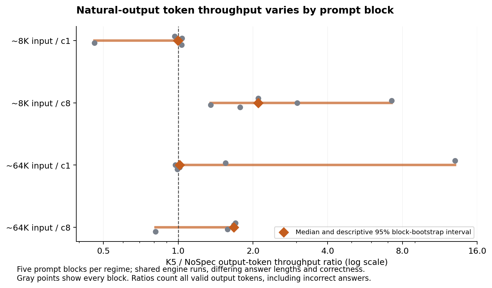
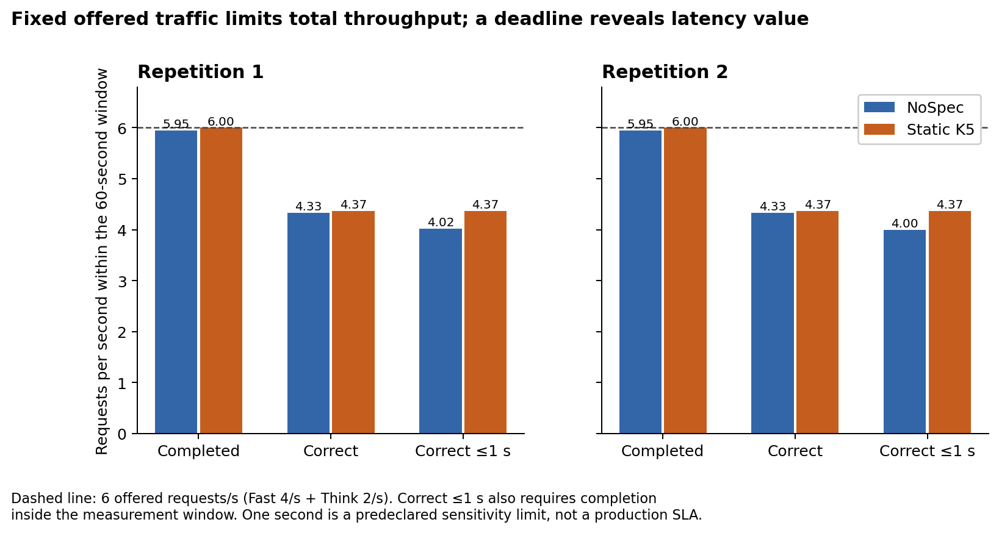
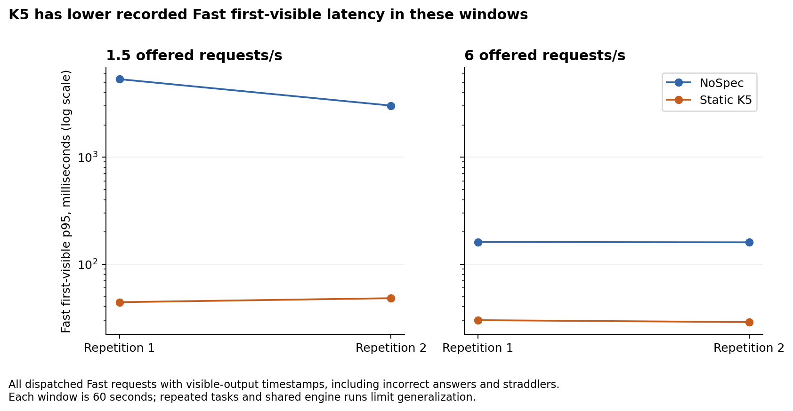
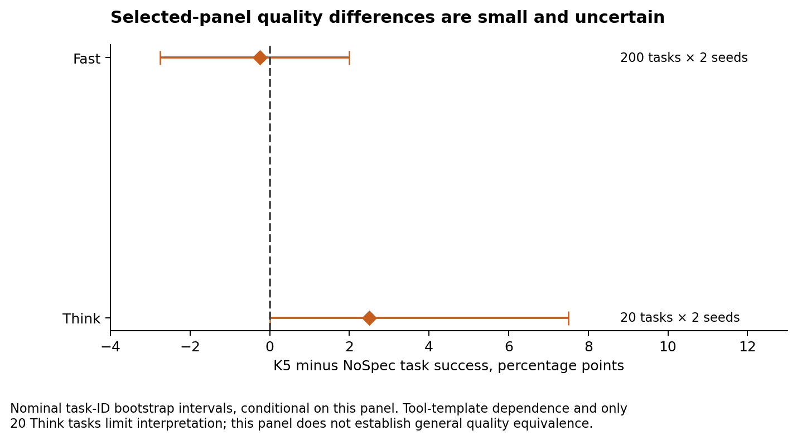

<!-- register: technical benchmark report | reader: ML researchers and inference engineers | consumed: evidence assessment and reproduction -->
# Comparing NoSpec and static DSpark K5 on eight B200 GPUs

Static DSpark K5 produced higher natural-output token throughput in the tested concurrent regimes and lower recorded first-visible latency in the mixed-load windows. Correct answers per second were nearly unchanged at the fixed offered rates. With a one-second end-to-end limit, however, K5 completed about 9% more correct answers per second at the higher mixed rate. The result depends on which useful-work metric is measured.

The comparison used two tensor-parallel replicas, each spanning four GPUs on one eight-B200 node, with captures collected November 8 to 9, 2026 UTC. NoSpec disabled speculation; static K5 used five speculative tokens, probabilistic draft sampling, block rejection enabled and adaptive verification disabled. These are whole-recipe comparisons under the recorded cache, routing and launch conditions. They do not isolate a kernel-level speculation effect.

| Measurement | Observed K5 / NoSpec result | Interpretation |
| --- | --- | --- |
| Natural output, approximately 8K input, eight concurrent requests | Median output-token throughput 2.10×; descriptive 95% interval 1.35 to 7.23× | Five prompt blocks; all favor K5, with wide variation |
| Natural output, approximately 64K input, eight concurrent requests | Median 1.67×; interval 0.81 to 1.70× | Four of five blocks favor K5; the interval includes a decrease |
| Natural output, one concurrent request | Medians 1.00× at 8K and 1.01× at 64K | No consistent single-request token-rate advantage across blocks |
| Mixed load, six offered requests/s | Correct-answer rate 1.008× in each 60-second repetition | Both recipes complete nearly all arrivals; correctness rates are similar |
| Same mixed load, correct answers completed within one second | 1.087× and 1.092× | A latency limit exposes a benefit hidden by unrestricted task-rate counts |
| Selected Fast quality panel | 71.5% NoSpec; 71.25% K5 | Difference −0.25 percentage points; task-cluster interval −2.75 to +2.00 points |

The one-second limit is one of four predeclared sensitivity limits, not a production service-level promise. Two short load repetitions, repeated task bodies and incomplete queue-drain sampling limit service-capacity conclusions.

## The measured configuration and workloads

| Component | Recorded configuration |
| --- | --- |
| Hardware | One node, eight NVIDIA B200 GPUs, 183,359 MiB reported memory per GPU |
| CPU and host memory | Two Intel Xeon Platinum 8580 CPUs; 160 logical CPUs, two NUMA domains; reported MemTotal 1,849,511,612 KiB, approximately 1,764 GiB |
| Topology | Two fixed TP4 engines behind one router, all serving components on the same node |
| Model | DeepSeek-V4.1-Flash-1017; checkpoint revision `1bae0e1088993b9b82de08f59de5be5a34e42170` |
| Runtime | vLLM `0.33.0rc1.dev447+ge0d00e4b8`; source revision `e0d00e4b8eb0c89ec30921d0695cfdd409e9c211` |
| Compute stack | Driver 580.173.02; Torch 2.14.0+cu130; CUDA 13.0; NCCL 2.30.7 |
| Serving image | `vllm/vllm-openai@sha256:aeb580d55ee3dcccd7b5c78d7871326f367bee5cfd8ca8e411c253d7983a0046` |
| Model metadata | Native checkpoint configuration reports dynamic FP8 quantization with FP4 experts; no extra weight conversion was introduced. This is configuration evidence, not a per-tensor precision audit. |
| Speculation | NoSpec reference versus static DSpark K5; [configuration and reproduction inventory](REPRODUCE.md#the-recorded-serving-recipe) |

Four measurements answer different questions. A forced-output anchor holds generation length at 2,048 tokens. Natural-stop bursts allow answer length and correctness to vary. A selected task panel measures quality with task-specific evaluators. Open-loop load offers requests on a fixed schedule and measures both timely completion and correctness.

Natural performance uses five prompt blocks for each single-length regime, shared across four sequential arm captures in NoSpec/K5 then K5/NoSpec order. Five prompt blocks are not five independent engine restarts. Cache reuse and shared engine history remain part of the measured recipe. Request bodies were matched between arms; output lengths and successes could differ.

The quality panel contains 200 Fast tasks: 50 coding, 50 grounded question-answering, 50 reasoning and 50 tool tasks, each with two seeds. The exploratory Think panel takes the first five selected tasks per family, for 20 task IDs with two seeds. That selection includes answerable grounded questions and five parameterizations of one tool template. Coding references were filtered through the retained compatibility policy before model scoring. Evaluators include isolated code tests, answer/abstention checks and inert multi-turn tool conversations. Dataset sources include [HumanEval](https://github.com/openai/human-eval), [SQuAD 2.0](https://rajpurkar.github.io/SQuAD-explorer/) and [GSM8K](https://github.com/openai/grade-school-math), plus synthetic tool templates. These are study-specific subsets and evaluators, not official full-dataset leaderboard scores.

Fast disables thinking; Think enables it using the pinned request encoder. The profiles share the same two-engine pool. Their exact encoded fields, task manifests, selection rules, exclusions and output caps are retained. Public-task contamination, the restricted coding policy and five synthetic tool templates constrain generalization. Repeated seeds and repeated template instances do not create independent tasks.

## Natural-output throughput varies across prompt blocks

Token throughput is total valid returned output tokens divided by the recorded burst span. “Valid” here means accepted transport/content framing, not a correct task answer. The plotted ratios include tokens from incorrect answers. The nominal 95% bootstrap intervals condition on the five observed prompt blocks and do not measure variation across independent deployments. In these small samples the interval endpoints equal the observed minimum and maximum; they are not a calibrated population-coverage or significance claim.

| Regime | Five block ratios, K5 / NoSpec | Median | Descriptive 95% interval |
| --- | --- | --- | --- |
| Approximately 8K input, c1 | 0.969, 1.036, 0.998, 0.460, 1.031 | 0.998 | 0.460 to 1.036 |
| Approximately 8K input, c8 | 2.103, 7.232, 3.017, 1.351, 1.775 | 2.103 | 1.351 to 7.232 |
| Approximately 64K input, c1 | 13.046, 1.550, 0.973, 1.015, 0.991 | 1.015 | 0.973 to 13.046 |
| Approximately 64K input, c8 | 1.702, 1.674, 1.684, 1.579, 0.809 | 1.674 | 0.809 to 1.702 |

Natural answers are short: single-request groups returned 3 to 16 tokens, while eight-request groups returned 29 to 103 tokens in total. Output volume therefore matters. In the first 64K/c1 block, K5 returned 16 tokens and failed the task, while NoSpec returned four and passed. The resulting 13.05× token-rate ratio combines four times as many tokens with a shorter measured duration; it is not a 13× useful-answer improvement. Conversely, two 8K/c8 blocks returned equal total token counts and still favored K5, so differing output lengths alone do not explain every gain.

The separate fixed-output anchor recorded 514.34 versus 254.74 output tokens per request-second, a 2.02× ratio, with approximately 8K input and 2,048 forced output tokens. It is one ordered synthetic pair. The natural c1 results show why that anchor should not become a general interactive speedup claim.

An additional mixed-length c8 block and a repeated-body c16 diagnostic remain labelled diagnostics. The c16 ratios were 2.52× at 8K and 1.32× at 64K, with one block per length, repeated bodies and substantial cache reuse. The NoSpec c16 capture failed its original evidence seal and was recovered without replay. Those measurements do not establish clean c16 scaling or capacity.

## Fixed offered traffic constrains completed-task throughput

The scored open-loop design offered Fast 1/s plus Think 0.5/s at the lower rate and Fast 4/s plus Think 2/s at the higher rate. Each arm has two 60-second repetitions at each mixed offered rate, one fixed-output anchor window and one Fast-only control at 4/s: six windows per arm. Maximum in-flight requests was 16. These settings define the offered workload; they do not establish a maximum sustainable arrival rate.

The mixed-load panel cycles ten underlying public questions: five reasoning and five answerable grounded questions, each encoded in Fast and Think form, yielding 20 profile/task variants. Selection took the first five scheduled task IDs in each family at seed 19 without filtering on model outcome. The load panel contains no coding or tool tasks. Hundreds of requests therefore represent repeated traffic over those ten questions, not hundreds of independent questions or the full four-family quality panel.

All scheduled arrivals were dispatched. Retained dispatch-fidelity checks passed; p95 lag was below 1.2 milliseconds in these windows. A separate, bounded second-client request agreed on the matched response's token counts and finish reason. It does not establish the load generator's capacity ceiling.

| Window | Offered requests | NoSpec completed / correct | K5 completed / correct | Correct-rate ratio |
| --- | --- | --- | --- | --- |
| Lower mixed, repetition 1 | 90 | 90 / 66 | 90 / 66 | 1.000 |
| Lower mixed, repetition 2 | 90 | 90 / 66 | 90 / 64 | 0.970 |
| Higher mixed, repetition 1 | 360 | 357 / 260 | 360 / 262 | 1.008 |
| Higher mixed, repetition 2 | 360 | 357 / 260 | 360 / 262 | 1.008 |
| Fast-only, one window | 240 | 238 / 166 | 240 / 168 | 1.012 |

Counts in this table require completion inside the measurement window. The original records also contain later completions; they are separated from in-window work.

At six offered requests per second, K5 completed all 360 arrivals in each window; NoSpec completed 357 before the boundary. K5 could not complete more arrivals than the test supplied. Correctness among in-window completions was also close: 262/360, or 72.78%, for K5 and 260/357, or 72.83%, for NoSpec. Together, those observations explain the nearly equal unrestricted correct-task rates in these windows.

The accounting identity is:

`correct tasks/s = offered tasks/s × dispatch fraction × in-window completion fraction × correctness among completions`.

It describes the recorded populations; it does not prove that either server reached saturation or that speculation caused a particular difference. The natural bursts and mixed-load windows also use different input/output distributions. Their ratios are not interchangeable measurements of one workload.

## A latency limit exposes a useful-work benefit

| End-to-end limit | Repetition 1: NoSpec → K5 correct tasks/s | Repetition 2: NoSpec → K5 correct tasks/s | K5 / NoSpec |
| --- | --- | --- | --- |
| 1 second | 4.017 → 4.367 | 4.000 → 4.367 | 1.087×; 1.092× |
| 5 seconds | 4.333 → 4.367 | 4.333 → 4.367 | 1.008×; 1.008× |
| 15 seconds | 4.333 → 4.367 | 4.333 → 4.367 | 1.008×; 1.008× |
| 60 seconds | 4.333 → 4.367 | 4.333 → 4.367 | 1.008×; 1.008× |

These are all four limits frozen in the load design. Each count requires both a correct answer completed inside the 60-second window and dispatch-to-completion latency within the named limit. The one-second counts are 241 versus 262 and 240 versus 262, respectively. They are descriptive results from two short windows with repeated task bodies, not an estimated production SLA or an independent-task confidence interval.

First-visible latency is elapsed time from actual dispatch to the first recorded nonempty visible-content event. It includes time spent producing any preceding hidden reasoning; reasoning events themselves do not end the interval. It is not necessarily first-token latency.

| Mixed rate | Fast first-visible p95: NoSpec, repetitions 1 / 2 | Fast first-visible p95: K5, repetitions 1 / 2 |
| --- | --- | --- |
| 1.5 total requests/s | 5.344 / 3.027 seconds | 0.044 / 0.048 seconds |
| 6 total requests/s | 0.161 / 0.160 seconds | 0.030 / 0.029 seconds |

This table includes every dispatched Fast request with a recorded visible-output clock, including incorrect answers and requests finishing after the window. Earlier aggregate summaries selected correctness-successful, in-window completions; that restriction materially changed some tails. Both cohorts are retained in the exported data. The checks validate recorded clocks and response integrity, not independently measured network-arrival timestamps for every streamed chunk.

NoSpec's much larger lower-rate tail shows that these samples do not support a smooth, causal latency-versus-load curve. Cache, engine history and request interactions were not independently varied enough to identify the cause. Report the observations rather than infer that adding traffic inherently improves latency.

## Selected-panel quality is similar within the study's limits

| Profile | Tasks × seeds | NoSpec correct | K5 correct | Difference, K5 minus NoSpec | Task-cluster 95% interval |
| --- | --- | --- | --- | --- | --- |
| Fast | 200 × 2 | 286/400, 71.5% | 285/400, 71.25% | −0.25 percentage points | −2.75 to +2.00 points |
| Think | 20 × 2 | 34/40, 85.0% | 35/40, 87.5% | +2.50 percentage points | 0.00 to +7.50 points |

These are nominal 95% paired task-ID bootstrap intervals, conditional on the selected panel, using 10,000 draws and carrying the two seed outcomes together. Resampling does not stratify the four families, cluster the five shared tool templates or resample deployments. Their uncertainty can therefore understate broader dependence. The Fast point estimates are close; the panel and smaller Think selection do not establish general quality equivalence. The CPU reproduction checks inspect representative original responses and retained isolated coding-score records; they do not execute model-generated code or re-establish every coding outcome.

Mixed traffic also affects latency without changing the offered Fast rate. In one Fast-only versus matched mixed comparison per arm, Fast successful-completion end-to-end p95 increased from 0.677 to 0.918 seconds for NoSpec and from 0.202 to 0.246 seconds for K5 when Think traffic was added at 2/s. These are descriptive comparisons with additional total traffic, not a statistically established interference mechanism.

## Evidence and claim boundaries

Upstream discussions cover [DSpark integration](https://github.com/vllm-project/vllm/issues/46910), [chat/thinking correctness on another GPU configuration](https://github.com/vllm-project/vllm/issues/62417) and [draft quantization on an AMD configuration](https://github.com/vllm-project/vllm/issues/65618). This comparison does not reproduce those reports or establish their applicability to the pinned B200 recipe. It reports measured outcomes rather than a new mechanism or a general correctness guarantee.

The evidence supports workload-specific comparisons of these two pinned recipes. Full sustained-service characterization remains incomplete: eleven of twelve load windows have no drain-phase queue sample and the remaining window has one sample with a running count of one. Client-recorded late completion and post-shutdown idle checks do not substitute for continuous queue-drain coverage. Missing samples do not establish zero queue.

Five failed event dispositions remain in the ledger, including the recovered NoSpec c16 and K5 load evidence seals. K5's recovered load windows are analysed with that provenance; they were not replayed and relabelled as clean original runs. The complete campaign used 7.182217 occupied node-hours, including startup and failures, with 3,771 reserved and 3,730 transmitted requests. Transport completion is distinct from task correctness.

The companion reproduction guide identifies pinned source/configuration/input inventories, all-point tables, representative sanitized responses, dataset attribution and exact archive hashes. Its CPU checks reproduce calculations and representative evaluations from retained artifacts. Fresh-node installation, independent laboratory replication, kernel attribution, broad quality equivalence and a maximum sustainable service rate remain outside the demonstrated evidence.

For this study, two TP4 replicas with static K5 are the stronger performance candidate for concurrent output-token throughput and recorded first-visible latency. NoSpec remains the reference and recovery recipe. A deployment decision must additionally qualify admission limits, cancellation, ingress/authentication, health monitoring and live recovery for the intended clients.
