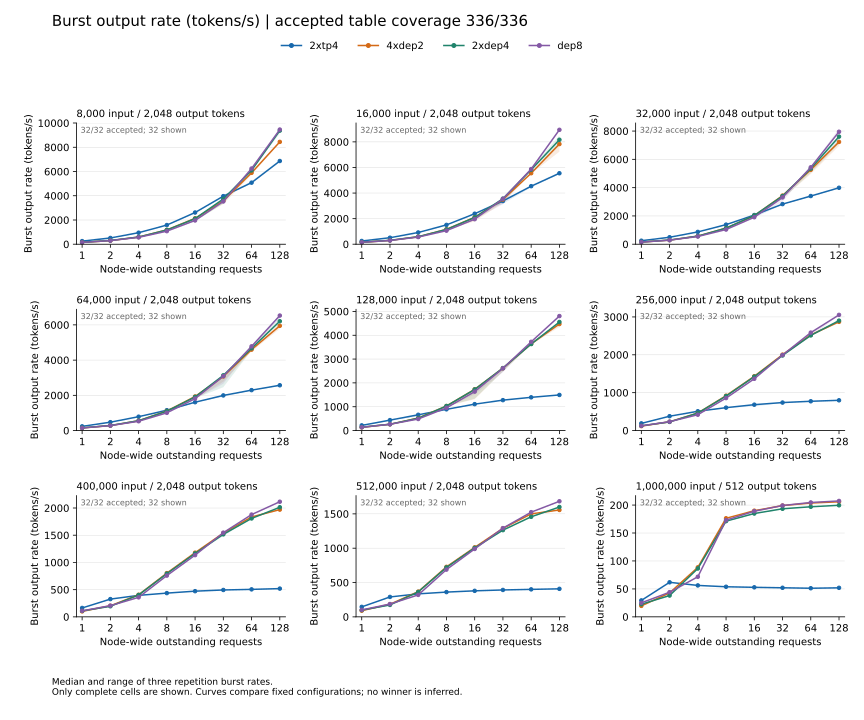
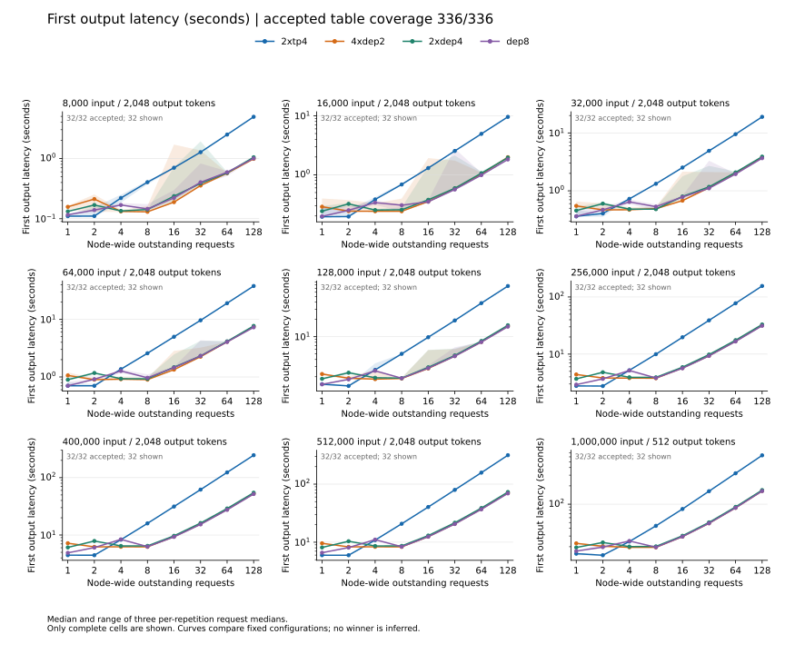
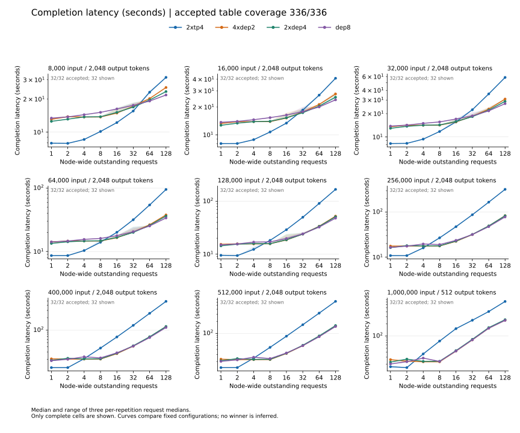
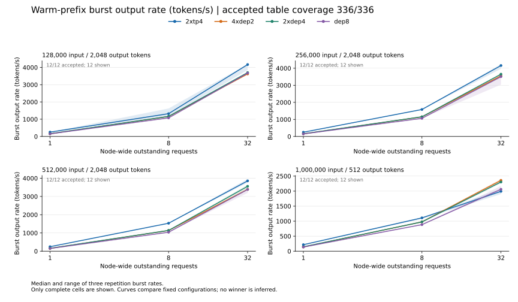
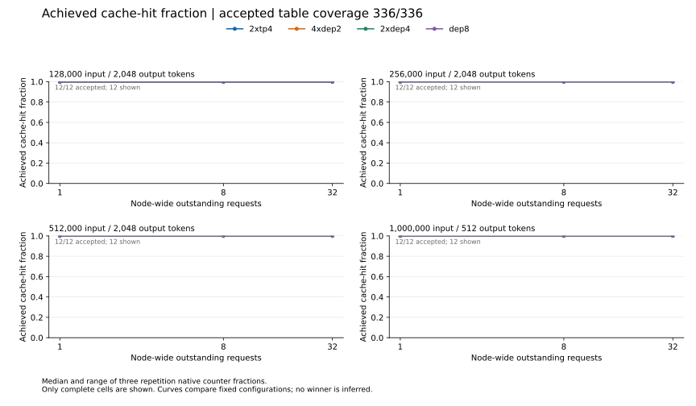

<!-- register: benchmark report | reader: serving engineer | consumed: result and chart inspection -->
# Descriptive fixed-configuration comparison

The tables contain 336 accepted cells of 336: 288/288 cold and 48/48 warm-prefix cells. They retain 1008 measured repetitions and 29,508 requests. Four-configuration matched coverage is 336 cells. Table coverage complete: true.

The charts use complete three-repetition cells only. Missing measurements stay blank and break curves. Shading shows the range across repetitions. Latency charts show the median and range of three per-repetition request medians, without pooling different repetitions. They do not show p95 or robust tail latency. Node-wide outstanding demand includes queued requests.

Cold measurements use cache-busted namespaces; cache flush or reset was not verified. Warm-designated misses stay in warm results with achieved native-counter hit fractions. A missing fraction is left blank. The one-million-input row requests 512 output tokens; other rows request 2,048.

This report presents finite bursts for the four frozen configurations. Necessary backend and KV-format differences are part of those configurations. It does not establish topology causation, optimal tuning, sustained capacity, task-quality equivalence or production reliability. All required configurations are matched; repetition variation and configuration-major time windows still limit rankings.

The portable table verifier recomputes timing and usage arithmetic before rendering. This rendering step grants no new raw-stream, profile, placement or telemetry acceptance, and does not itself establish final campaign completion. The separate retained final raw and lifecycle audits accepted the complete campaign. Original source-bound capture audits and the final campaign audit remain separate evidence.

## Cold burst rate

## First output latency

## Completion latency

## Warm-prefix burst rate

## Achieved warm-prefix cache reuse

## Reproduce the figures

Install the pinned report requirements in an isolated Python environment, then run `python3 -B reproduce/render_comparison_report_presentation.py TABLE_DIRECTORY FRESH_OUTPUT_DIRECTORY`. The input is a sealed sanitized table directory, not an unverified result summary. `provenance.json` records source fingerprints and the generator and plotting versions. Existing output directories are rejected. A failed input check leaves prior reports unchanged.
