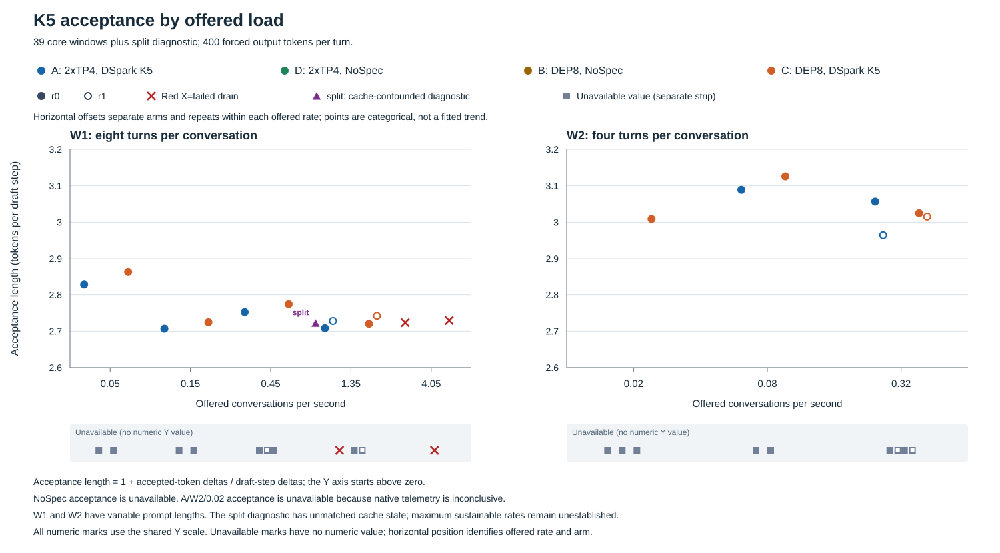
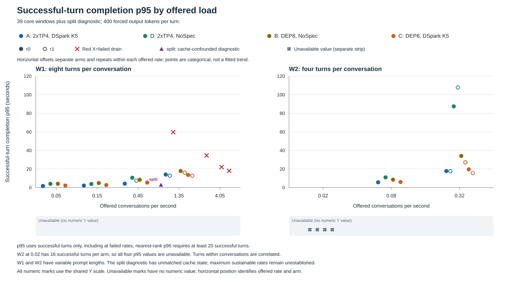

<!-- register: technical benchmark report | reader: serving engineers | consumed: results and methodology review -->
# K5 acceptance ranged from 2.707 to 3.126; no maximum rate is established

On one eight-B200 node running vLLM 0.33.0rc1.dev447+ge0d00e4b8, measured K5 acceptance length ranged from 2.707 to 2.864 in W1 and 2.964 to 3.126 in W2 across 39 core windows. Acceptance length is `1 + sum(accepted-token deltas) / sum(draft-step deltas)`, in tokens advanced per draft step, summed across distinct exporter/full-label series. NoSpec acceptance is unavailable. K5 uses five draft tokens, probabilistic draft sampling, block rejection and adaptive verification off.

The four recipes were A: 2xTP4 with DSpark K5, D: 2xTP4 without speculation, B: DEP8 without speculation and C: DEP8 with DSpark K5. Layouts use different attention backends, KV-cache formats and sequence limits, so cross-layout differences apply to the complete recipes. All maximum sustainable rates remain null, including the p95 completion tiers of 30 and 60 seconds, because the client-fidelity control was inconclusive.

The package contains five historical A windows and 35 continuation captures, including one split-client diagnostic. The continuation raw audit verified 88,431 files, 66,240 reconstructed streams and usage and timing for 65,483 successful streams. It found no source-availability or matched-input gaps. Historical A windows have a separate accepted audit; the audit scopes are recorded in [audit-summary.json](audit-summary.json).

## Finite-window outcomes include four failed rates

Offered rates are new conversations per second; r0 is the original window and r1 its repeat. Each window has 60 seconds of warm arrivals, 360 seconds of measured arrivals and at most 120 seconds to drain. The failed-drain rows are A/W1/4.05 r0, D/W1/1.35 r0, B/W1/4.05 r0, C/W1/4.05 r0. A W1 4.05 remains the original historical failure; the other three were not replayed. D W1 4.05 was not attempted after the lower D failure and is unmeasured, not a zero or unsupported finding. A W2 0.02 completed its client turns but native coverage was inconclusive after its wrapper mismatch, so acceptance and sustainability are inconclusive rather than overload. The unmatched D W1 0.45 repeat is retained in the public table.

W1 has eight sequential turns and W2 has four. Their nominal 64K/256K labels describe calibration targets: actual prepared prompts span **45,075 to 117,842 tokens in W1 and 219,003 to 445,038 in W2** across the indexed populations, including warm-up. Real-text token density varies between conversations. Matching arms reuse exact input bytes, but these are broad prompt-length workloads, and the first three warm-up checks do not establish a narrow length distribution. Per-turn ranges are retained in [measurement-details.json](measurement-details.json).

New conversations follow frozen Poisson arrival traces. Each turn appends a fixed transcript, so generated answers cannot change later prompts. The client requests exactly 400 output tokens with EOS ignored, temperature/top-p 1.0 and thinking disabled. The global client ceiling is 256 workers; the split uses 128 per client. A consistent-hash router uses a conversation session header to retain replica or DP-rank affinity. [configuration.json](configuration.json) records the pinned model/tokenizer/image, complete serving arguments, GPU grouping and scheduler limits.

Completion-window throughput is output tokens from successful turns finishing in the nominal 360-second interval, divided by 360 and eight GPUs, in output tokens/s/GPU. Measured-cohort output through drain is divided by its first-scheduled-to-last-terminal elapsed seconds, in output tokens/s for the whole node. Completion latency is dispatch to terminal for successful measured-cohort turns, including successful turns at failed rates. The p95 and p99 nearest-rank cutoffs require successful-turn populations of 20 and 100; turns within conversations are correlated. First-output and stream decode timing uses nonempty chunks, which may contain multiple tokens and are not token clocks. Native counter brackets are approximately 365 seconds and have their own recorded denominator.

The complete rows and elapsed counter brackets are in [cells.csv](tables/cells.csv), with dispositions in [coverage.csv](tables/coverage.csv) and [coverage.json](coverage.json). [measurement-details.json](measurement-details.json) includes conversation arrival/start/completion rates, dispatch lag, latency ranges, warm-up/drain token totals and sampled client/engine backlog traces. Its per-window completion-tier flags check latency only; the reported sustainable-rate tiers remain null. [native-aggregates.csv](tables/native-aggregates.csv) preserves acceptance/cache denominators and series counts. DEP8 uses one exporter with eight distinct engine label sets after duplicate pulls are removed.

## Split control is cache-confounded

The one-client W1 1.35 repeat had native prefix hit fraction 0.8559437096809002, while the split had 0.9989958895790336. These are unmatched effective cache states. The split completes 4,568 requests with disjoint client indexes, but faster p95 (2.963 versus 12.778 seconds) does not qualify client fidelity, capacity or cache-salt behavior. Disposition is **INCONCLUSIVE_CACHE_STATE_CONFOUNDED**, diagnostic only; root cause remains unresolved. Exact values are in [diagnostic-client-control.json](diagnostic-client-control.json).

Initial B and C literal-CPU deployments were invalid attempts, not model incompatibility evidence. Corrected B/C used the canonical server partition. Corrected C passed strict natural stop, an 8,192-token forced-output check at 52,019 input tokens and 64K-class warm-up with native K5 movement within its original clock.

A/D differ in speculation and its required metrics flag. A also enables Responses storage, which the installed source reads only in the unmeasured Responses route; compilation-cache backing differs at the same container path. B/C differ in speculation and compilation-cache backing. These explained differences remain in provenance; startup and Responses equivalence are untested. The original endpoint passed independent restoration, generation and new stored-response round-trip checks; prior stored Responses were lost on restart.

The optional final A drift window was omitted, so temporal stability remains unresolved. D 0.05 also overlapped read-only coordinator configuration/source checks with unquantified perturbation; keep its row descriptive and provisional.

## External context and reproduction limits

NVIDIA publishes a 990.57 output-token/s/GPU operating point at concurrency 168 for 64K/400 on 2xTP4 with K3 in the [Dynamo DeepSeek V4.1 Flash recipe](https://docs.nvidia.com/dynamo/dev/recipes/deepseek-v4-1-flash). Its backend/KV, scheduler/routing, demand protocol, prompt-length distribution, window settings and pinned model revision differ from this study. Weight identity across the two model revisions is unestablished. No direct speedup or capacity ratio follows.

Sources are retained by measured hash in [source-retention.json](source-retention.json). Exact text and raw streams remain private; corpus origins, hashes and licenses are in [input-origin.json](input-origin.json). The separate portable replay applies only three small guards to measured code and is not a claim of fresh-node or full-benchmark reproduction. See [REPRODUCE.md](REPRODUCE.md).
